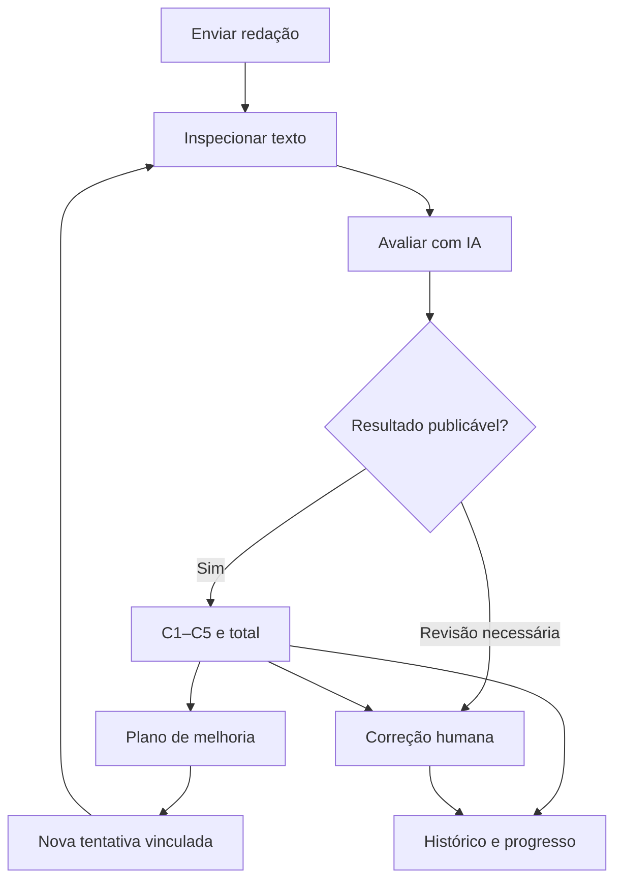

# Plano de frontend — Corretor ENEM IA

**Data:** 16/10/2026. **Destino:** implementação no repositório existente.

**Objetivo:** transformar o MVP em um ciclo de treino: enviar uma redação, entender a avaliação da IA, reescrever, solicitar correção humana e acompanhar a evolução.

Este documento é uma especificação, não uma implementação. Parte do README atual fornecido e do anexo “Plano v3 — integração local do corretor ENEM com Gemma E2B”. O código não foi inspecionado. O README atual prevalece sobre tarefas ainda descritas como futuras no plano anterior. Endpoints novos e nomes de entidades abaixo são propostas, a adaptar ao repositório.

## 1. Decisões de produto

| Assunto | Decisão |
| --- | --- |
| Escopo | Redações do ENEM, avaliadas por C1–C5; provas objetivas ficam fora desta entrega. |
| Papel da IA | Treinadora: oferece uma estimativa experimental e explica pontos de melhoria. |
| Papel do humano | Faz uma avaliação independente da mesma versão do texto. Sua nota fica identificada como correção humana da plataforma, não como nota oficial do ENEM. |
| Reenvio | Uma reescrita cria outra tentativa vinculada à anterior; não sobrescreve texto ou notas antigos. |
| Revisão humana | O aluno pode solicitar quando quiser, inclusive com nota baixa ou quando a IA exigir revisão. Não haverá nota mínima para liberar o botão. |
| Progresso | Mostrar notas e evidências de mudanças, com séries separadas para IA e humano. |
| Aprendizado do sistema | Guardar pares para curadoria e avaliação; experimentar RAG depois de medir o baseline. |
| Primeira entrega | Fluxo do aluno + histórico de tentativas + painel mínimo do corretor. RAG ativo vem depois. |

Preservar Java 21/Spring Boot, SQLite/Flyway, OCR, `LlmGateway`, Ollama local, auditoria, cache e validações. Não refazer a integração com o modelo.

## 2. Jornada principal

Na inspeção, PDF/imagem exige conferência da transcrição antes da IA. Texto digitado segue a regra atual de dispensar revisão de OCR, com oportunidade de conferir tema e conteúdo. Falhas técnicas permanecem na tela de acompanhamento com recuperação; não viram notas.

Navegação principal: **Nova redação**, **Minhas redações** e **Meu progresso**. O perfil de corretor ganha **Correções pendentes**. Não criar menu de modelos ou planos `cheap/normal/premium`, pois hoje são aliases sem diferença de qualidade.

## 3. Telas do aluno

### Tela A — Enviar redação

**Propósito:** informar a proposta e fornecer o texto com o menor atrito possível.

- Campo obrigatório de tema; título da redação é opcional e não substitui o tema.
- Proposta completa e textos motivadores, quando disponíveis. Se ausentes, informar a limitação na avaliação.
- Abas **Digitar texto**, **Enviar imagem** e **Enviar PDF**.
- Área de upload com seleção por botão, arrastar/soltar e prévia. Mostrar formatos, tamanho e quantidade de páginas aceitos a partir dos limites reais do backend.
- Exibir andamento real do upload quando disponível; não confundir upload, OCR e avaliação.
- Preservar rascunho ao trocar de tela. Antes de enviar outro arquivo sobre um rascunho preenchido, explicar a substituição.
- Botão **Continuar para inspeção**; desabilitar durante o envio e apresentar erros junto ao campo correspondente.

Ao vir de **Reescrever e enviar novamente**, abrir esta mesma tela com tema/proposta e vínculo à tentativa anterior. Mostrar “Nova tentativa da mesma redação”. Permitir digitar uma nova versão ou enviar outro documento. Troca substancial de tema cria uma nova redação, sem comparação direta de reescrita.

### Tela B — Inspecionar e acompanhar

Esta é a tela solicitada para o período de carregamento, com dois momentos claros.

**B1. Conferir a entrada**

Desktop: documento à esquerda e transcrição à direita. Celular: alternância **Documento / Texto**. PDF precisa de navegação por páginas; imagem, de zoom e rotação de visualização quando suportados.

No PDF/imagem, oferecer edição da transcrição e confirmação **“Conferi: o texto corresponde ao que escrevi”**. Explicar: “Corrija apenas diferenças da transcrição. Para melhorar a redação, crie uma nova tentativa depois.” Preservar os erros originais do aluno.

Um trecho ilegível deve permitir substituir o arquivo ou revisar o texto; não inventar palavras. Alertas de baixa confiança só aparecem se o OCR realmente os fornecer. Não mostrar CER/WER em produção sem transcrição de referência.

O botão **Confirmar texto e avaliar** salva a revisão aprovada antes de chamar a avaliação. Se já existir mecanismo de aprovação documental, reutilizá-lo. Depois do envio, o texto daquela tentativa fica congelado.

**B2. Acompanhar a avaliação**

- Manter o texto visível em modo de leitura.
- Mostrar etapas reais: **Texto confirmado → Avaliação em andamento → Resultado disponível**.
- Usar indicador indeterminado durante a geração: “Analisando sua redação pelas cinco competências”.
- Não animar C1, C2 etc. como se chegassem separadamente: o backend atual faz uma única geração estruturada.
- Não inventar percentual ou tempo restante. Exibir tempo decorrido; estimativas só depois de medir latência real.
- Enquanto aguarda, explicar brevemente as cinco competências, sem simular um resultado.
- Ao concluir, abrir o resultado da mesma tentativa; ao retornar à página, consultar o estado persistido.

O comportamento de continuar após fechar a aba depende do backend. Verificar e implementar persistência/recuperação antes de prometer “pode sair, avisaremos quando terminar”. Fechar a tela não deve disparar outra avaliação.

### Tela C — Resultado resumido

**Cabeçalho:** tema, tentativa, data e selo **“Avaliação por IA · experimental”**. Em modo fake, substituir por **“Demonstração — resultado simulado”**, com destaque inequívoco.

**Área principal:** cinco cartões empilhados, sempre na ordem C1–C5. Cada um contém nome acessível, nota `/200`, barra visual, justificativa curta e acesso aos detalhes.

| Competência | Nome exibido | Conteúdo resumido |
| --- | --- | --- |
| C1 | Escrita formal | Domínio da escrita formal da língua portuguesa. |
| C2 | Tema e repertório | Compreensão da proposta, texto dissertativo-argumentativo e uso pertinente de conhecimentos. |
| C3 | Argumentação | Seleção, organização e desenvolvimento de argumentos em defesa de um ponto de vista. |
| C4 | Coesão | Uso dos recursos linguísticos para conectar e construir a argumentação. |
| C5 | Proposta de intervenção | Proposta articulada ao problema, com respeito aos direitos humanos. |

Os nomes curtos são rótulos de interface. Os descritores e níveis devem vir da rubrica versionada do backend, conferida com a Cartilha do Inep [1].

**Ao final dos cinco cartões:** total em destaque, `NNN / 1000`, fornecido pelo backend. As barras usam a nota publicada, sem recalcular a avaliação no navegador. Não apresentar estimativas de percentil, aprovação ou classificação sem dados.

**Painel de ações à direita no desktop, abaixo no celular:**

1. **“Quero melhorar minha redação”** — ação principal. Subtexto: “Veja os pontos de ajuste e prepare sua próxima versão”.
2. **“Solicitar correção humana”** — ação secundária sempre acessível após a confirmação do texto, inclusive em revisão obrigatória.
3. **“Ver minhas tentativas”** — navegação discreta.

Após solicitar, trocar o botão humano por **“Correção humana solicitada”** e permitir acompanhar o pedido. Quando publicada, apresentar **IA** e **Humano** lado a lado, inclusive por competência. Não substituir, somar ou tirar média entre essas notas.

Se a avaliação estiver bloqueada, mostrar **“Esta redação precisa de revisão”**, motivo compreensível e ação adequada. `total: null` significa nota indisponível, não zero. Um humano ainda pode publicar sua avaliação independentemente da conclusão da IA.

### Tela D — Plano de melhoria

**Propósito:** converter o feedback em tarefas de reescrita, sem fazer o trabalho pelo aluno.

Começar com **“Por onde começar”**, destacando até três prioridades sustentadas pelo resultado. Priorizar problemas relevantes; nota menor pode ordenar a lista, mas não determina sozinha a importância pedagógica. Se não houver informação suficiente, não inventar uma prioridade específica.

Para cada competência, apresentar:

| Bloco | Comportamento |
| --- | --- |
| O que funcionou | Ponto positivo sustentado no texto, quando disponível. |
| Trecho analisado | Citação literal e destaque na redação, quando houver. |
| Por que recebeu esta nota | Justificativa existente e relação com o descritor da rubrica. |
| O que melhorar | Problema ou ausência apontada na avaliação. |
| Como praticar | Ação concreta; distinguir orientação específica de orientação geral da competência. |
| Minha revisão | Checklist pessoal “Quero trabalhar nisso / Revisei este ponto”. Não altera nota nem comprova melhora. |

Um comentário sobre ausência pode não ter trecho associado. Para trechos repetidos, destacar a ocorrência identificada pelo backend ou todas como ambíguas; não inventar posição. Preferir localização pelo backend e texto escapado, sem renderizar conteúdo do aluno ou modelo como HTML confiável.

**Exemplo fictício de orientação de C3:** “Você apresenta uma consequência, mas ainda não explica como ela decorre do problema. Reescreva esse parágrafo acrescentando a relação de causa e consequência.” Só usar esse tipo de diagnóstico quando sustentado pela avaliação da redação.

**Limite importante do MVP:** o contrato atual descreve evidências, problemas e motivos, mas não garante um tutorial completo. A primeira tela detalhada organiza esses dados e complementa com orientações gerais revisadas, identificadas como gerais. Não ampliar afirmações por suposição.

Se faltar orientação específica, avaliar uma extensão pequena e versionada do schema, produzida na mesma chamada. Medir tokens, truncamento e latência antes de adotá-la. Abrir esta tela não chama o LLM novamente. Um tutor conversacional fica fora da primeira entrega.

Botões finais: **“Reescrever e enviar novamente”** e **“Voltar ao resultado”**. O primeiro abre a entrada já vinculada à tentativa atual; um botão genérico “Voltar ao início” perderia essa relação.

### Tela E — Minhas redações

Organizar por tema/proposta e agrupar as tentativas de cada redação.

Cada item mostra tema, última atividade, quantidade de tentativas, notas recentes de IA/humano e situação da revisão humana. Ao abrir, mostrar a sequência de versões com acesso ao texto, resultado e feedback de cada uma.

Estados vazios precisam de ação clara: **“Você ainda não enviou uma redação. Começar agora.”** Resultados com falha ou revisão pendente continuam visíveis, com `—` no lugar de nota. Não usar apenas cor para diferenciá-los.

### Tela F — Meu progresso

Oferecer duas visões:

- **Nesta redação:** comparar tentativas do mesmo tema, sobretudo primeira e mais recente. É a visão principal para avaliar uma reescrita.
- **Ao longo do tempo:** panorama de prática, com filtro por competência e indicação de mudanças de tema e configuração da IA.

Mostrar gráfico simples de notas com pontos distintos para IA e humano; uma linha não deve continuar a outra. Disponibilizar também tabela acessível. Quando o humano corrigir depois, vincular sua nota à tentativa original e mostrar a data de publicação, sem criar uma tentativa fictícia.

**Exemplo fictício de comparação:**

| Indicador | Tentativa 1 | Tentativa 2 | Variação |
| --- | ---: | ---: | ---: |
| C1 — IA | 120 | 160 | +40 |
| C2 — IA | 160 | 160 | 0 |
| C3 — IA | 80 | 120 | +40 |
| C4 — IA | 120 | 160 | +40 |
| C5 — IA | 120 | 160 | +40 |
| Total IA | 600 | 760 | +160 |
| Total humano | — | 680 | Comparação humana ainda indisponível |

Complementar a nota com comparações verificáveis de trechos. Distinguir **“Você marcou como revisado”**, **“A nova avaliação sugere melhora”** e **“Melhora confirmada pelo corretor”**. Um problema que deixou de aparecer no feedback não está automaticamente resolvido: a resposta pode ter omitido o item.

Guardar achados estruturados quando disponíveis, com competência, tipo de problema, evidência e origem. Na ausência deles, mostrar diferenças de texto e avaliações lado a lado; evitar um resumo automático inventado de progresso.

Falhas, `null` e fake não entram nas médias/gráficos de desempenho real. Se modelo, prompt, rubrica ou RAG mudarem, marcar a mudança e separar comparações incompatíveis. Aumento de nota isolado não prova ganho de aprendizagem.

## 4. Correção humana: pedido e painel do corretor

O endpoint existente de notas humanas não equivale a um sistema de solicitação. Acrescentar o fluxo necessário, reutilizando a persistência já disponível.

### Solicitação pelo aluno

O pedido aponta para a tentativa e a revisão exata do texto. Capturar o `runId` da avaliação exibida quando existir, para formar o par correto; não procurar apenas “a última IA” depois que o corretor terminar.

Estados propostos do pedido: **solicitada → em correção → concluída**, com **cancelada** para os casos permitidos. Mostrar prazo apenas se houver uma política operacional real. Não simular professor disponível, posição na fila ou notificação por e-mail.

Uma solicitação ativa por tentativa, com proteção no servidor contra duplicidade. Nova tentativa não altera um pedido anterior; pode receber outro pedido, informado como separado.

### Painel mínimo do corretor

- Lista paginada de pedidos, tema, data e estado; filtro por pendentes/em correção/concluídos.
- Atribuição ou reserva do pedido com controle de concorrência entre corretores.
- Texto aprovado, tema/proposta e documento original, quando houver.
- Cinco campos de nota, justificativas, evidências e orientação principal; rascunho e publicação separados.
- Para um avaliador individual, usar a escala 0/40/80/120/160/200 por competência, conforme o contrato atual. Dados históricos agregados precisam de outro tipo/escala, sem arredondamento forçado.
- Reutilizar o cálculo de total no backend. Campos incompletos não permitem publicação.

**Avaliação independente:** ocultar nota e feedback da IA até o humano publicar sua primeira avaliação. Aplicar a restrição também na API, não apenas no componente visual. Depois, disponibilizar comparação para análise das divergências.

O corretor não vê a nota, mas pode saber o motivo de um encaminhamento obrigatório quando isso for necessário para revisar o caso; registrar essa circunstância na avaliação. Anulação ou inelegibilidade global exige decisão e motivo próprios, sem improvisar regras a partir do total.

Notas humanas publicadas são versionadas. Ajuste posterior registra autor, data e motivo; não apaga o julgamento original. Divergências importantes ou casos difíceis podem passar por segundo corretor/curador, com limiares internos definidos antes de medir o sistema. Não apresentar esse processo como equivalente à correção oficial do ENEM.

O aluno recebe comparação clara, mesmo se a nota humana for menor. Uma explicação útil é: **“A correção humana identificou aspectos que a estimativa da IA não capturou. Veja os comentários para orientar a próxima versão.”**

## 5. Estados e mensagens: contrato da interface

Manter três estados independentes: **documento**, **avaliação da IA** e **pedido humano**. “Revisão pendente” sozinho é ambíguo.

| Situação atual | Mensagem/ação no frontend |
| --- | --- |
| Documento aguardando conferência | “Confira o texto extraído para continuar.” Abrir inspeção. |
| `RUNNING` | “Sua redação está sendo avaliada.” Consultar estado; não mostrar nota anterior como atual. |
| Resultado válido publicável | Exibir C1–C5 e total; preservar o selo experimental. Confirmar no código qual é o status de sucesso. |
| `NEEDS_REVIEW` | “Precisamos de revisão humana antes de apresentar uma nota.” Exibir motivo compreensível e encaminhamento. |
| `FAILED` | Exibir motivo e ação de recuperação; nunca preencher nota com zero. |
| `STALE` / `STALE_REVISION` | “Esta avaliação pertence a uma versão anterior.” Abrir a versão correta; não promover o resultado. |
| `EVALUATION_BUSY` | “Há outra avaliação em andamento. Tente novamente quando ela terminar.” Não afirmar que o pedido está na fila. |
| `DOCUMENT_REVIEW_REQUIRED` | Voltar à aprovação documental; não permitir contornar o bloqueio. |
| `RUNTIME_UNAVAILABLE`, `MODEL_NOT_FOUND`, `RUNTIME_QUARANTINED` | “A avaliação por IA está indisponível no momento.” Preservar o texto; detalhes técnicos no diagnóstico. |
| `INFERENCE_TIMEOUT` ou perda de conexão | Consultar o estado persistido antes de oferecer nova tentativa de avaliação. |
| `INVALID_RESPONSE`, `TRUNCATED_RESPONSE` | “Não foi possível concluir uma avaliação válida.” Nenhuma nota parcial publicada. |
| `CONTEXT_LIMIT` | Explicar o limite e orientar conferência da proposta/arquivo. Não cortar o texto silenciosamente. |
| `provider: fake` | Resultado de demonstração claramente identificado; excluir de métricas reais e pares de qualidade. |

O backend é a autoridade para publicação: `RUNNING`, `FAILED`, `STALE` e `NEEDS_REVIEW` continuam com `total: null`. A UI não soma competências para fabricar um total quando o servidor o bloqueou. Uma nota humana válida continua independente desses estados da IA.

## 6. Integração com o backend existente

### Contratos informados como existentes

| Endpoint | Uso previsto |
| --- | --- |
| `GET /api/runtime` | Identificar demonstração/experimental e disponibilidade. Modelo/digest ficam em detalhes técnicos. |
| `POST /api/essays` | Criar a entrada seguindo o contrato atual de texto/arquivo. Conferir formato e limites reais. |
| `POST /api/essays/{id}/evaluate?profile=normal` | Disparar uma avaliação após aprovação do texto. |
| `GET /api/essays/{id}/result` | Recuperar resultado/estado atual, validando a revisão associada. |
| `GET /api/runs/{runId}` | Consultar a execução identificada e evitar misturar resultados. |
| `POST /api/essays/{id}/human-scores` | Reutilizar para publicar notas humanas, com autorização de corretor e associação à revisão. Não expor como formulário de nota do aluno. |

Antes de desenvolver os componentes, mapear os DTOs reais. Não supor que campos ilustrativos deste plano já existem.

### Capacidades adicionais necessárias

Os caminhos abaixo são sugestões. Reutilizar equivalentes existentes antes de criar novos.

| Capacidade | Contrato candidato |
| --- | --- |
| Recuperar texto, documento e revisão | `GET /api/essays/{id}` e acesso autorizado ao documento |
| Editar/aprovar transcrição | Reutilizar o fluxo documental existente; caso ausente, definir endpoints de revisão/aceite |
| Listar redações/tentativas do aluno | `GET /api/me/essays` com paginação |
| Criar reescrita vinculada | Estender criação com vínculo à tentativa anterior, validado pelo servidor |
| Solicitar revisão humana | `POST /api/essays/{id}/human-review-requests` |
| Acompanhar pedido | `GET /api/essays/{id}/human-review-request` |
| Operar fila do corretor | `GET /api/reviewer/review-requests` e ações de assumir/salvar rascunho |
| Obter progresso | `GET /api/me/progress`, ou agregação inicial das tentativas autorizadas |

A lista de capacidades é mais importante que os nomes das rotas.

### Avaliação longa e recuperação

O endpoint atual é síncrono, com timeout padrão de 600 s. Na primeira fase:

1. Disparar o POST uma vez; não configurar retry automático para essa mutação.
2. Consultar o estado via GET enquanto aguarda, inicialmente a cada 3–5 s, espaçando em falhas transitórias. Não sobrepor requisições GET.
3. Garantir associação de resposta a aluno, redação, revisão e execução; respostas atrasadas não podem atualizar outra tela/tentativa.
4. Ao recarregar, obter o estado no servidor antes de oferecer “Avaliar”.
5. Tratar timeout de transporte como estado incerto até consultar o backend. `AbortController` no navegador não comprova cancelamento da inferência.
6. Proteger cliques repetidos e abas concorrentes por idempotência/single-flight no servidor. Uma única inferência local ativa continua sendo o limite.

Se `/result` não devolver revisão/execução suficientes, essa é uma pequena extensão necessária. Verificar também o que acontece quando a conexão do POST cai ou o processo reinicia.

Uma melhoria posterior pode aceitar o pedido com `202` e `runId` persistido. Isso exige execução e recuperação reais no backend; trocar só a resposta HTTP não cria processamento confiável em segundo plano. Não adicionar fila distribuída para o MVP local.

## 7. Modelo mínimo de informação

Separar conceitos sem impor novas tabelas quando o modelo atual já os representa.

| Conceito | Dados/regras essenciais |
| --- | --- |
| Redação em treino | Dono, tema/proposta e agrupamento de tentativas. |
| Tentativa | ID, vínculo à anterior, número, data, origem e revisão do texto aprovado. Pode reutilizar o `essay` atual com um agrupador. |
| Revisão documental | Texto literal, hash, documento de origem, responsável e momento da aprovação. |
| Avaliação IA | `runId`, tentativa/revisão, estado, C1–C5, total elegível, evidências, configuração e auditoria existentes. |
| Pedido humano | Tentativa/revisão congelada, execução IA de referência quando houver, estado, corretor e datas. |
| Avaliação humana | C1–C5, comentários, evidências, autor, rubrica, versão e estado de publicação. |
| Checklist do aluno | Tarefas e marcações pessoais; não equivale a rótulo pedagógico validado. |
| Elegibilidade de corpus | Autorização de uso, curadoria, anonimização, versão do rótulo e grupo de separação dos conjuntos. |

Uma tentativa pode ter várias execuções técnicas; isso não aumenta a contagem de reescritas. Para o gráfico, selecionar explicitamente uma execução válida de referência por tentativa/configuração. Reexecutar a mesma versão não pode inflar a quantidade de prática.

Depois de avaliar ou solicitar revisão humana, a revisão fica imutável. Correção tardia de OCR gera nova revisão rastreada e nova avaliação; nunca reaproveita notas de outro texto. Uma melhora intencional do aluno cria nova tentativa.

## 8. RAG: preparar a base agora, ativar depois

**Guardar correções não treina automaticamente o modelo.** Nesta proposta, RAG significa recuperar exemplos humanos aprovados e fornecê-los como contexto de uma nova avaliação. Atualizar essa base não altera os pesos do Gemma. Fine-tuning/LoRA continua sendo outro experimento. O trabalho original de RAG distingue memória nos parâmetros de memória externa recuperável [2].

### O que guardar desde a primeira entrega

Para cada par: texto aprovado/hash, tema/proposta, tentativa/revisão, avaliação IA original/configuração, notas e justificativas humanas, autoria da revisão, datas, versão da rubrica e permissões de uso. Se a IA falhou, guardar o exemplo humano e a falha; não inventar um par numérico.

Manter dois produtos diferentes: **histórico privado do aluno** e **exemplo aprovado para o corpus**. Publicar uma nota humana não insere automaticamente a redação no RAG. O corpus requer curadoria, escopo de uso permitido e remoção de identificadores desnecessários.

Na recuperação, a referência pedagógica é a avaliação humana aprovada. A previsão antiga da IA permanece para auditoria/medição, sem ser reapresentada como resposta correta.

### Cuidado com a seleção dos exemplos

Os alunos tenderão a solicitar revisão quando a IA der nota alta. Essa amostra serve ao produto, mas não representa todas as dificuldades da população. Planejar também revisões autorizadas de diferentes faixas de nota, temas e casos de revisão/falha. Identificar a origem da seleção nos relatórios.

### Experimento posterior

1. Medir o baseline sem RAG com o benchmark autorizado existente.
2. Definir um corpus curado de exemplos de desenvolvimento; manter validação/teste fora do índice e dos prompts.
3. Agrupar versões/duplicatas da mesma redação para impedir vazamento. Respeitar também os agrupamentos de autor e tema definidos no protocolo do benchmark.
4. Recuperar poucos exemplos ou trechos relevantes, com contexto suficiente para entender a justificativa. Não transferir a nota de um texto “parecido” para outro.
5. Excluir a própria redação e suas reescritas da recuperação da avaliação. Feedback anterior do aluno pode aparecer no acompanhamento, mas não deve contaminar o par de avaliação independente.
6. Tratar redações e exemplos recuperados como dados, não instruções. Nenhum texto de outro aluno pode aparecer ao usuário sem autorização específica de compartilhamento.
7. Registrar IDs/versões dos exemplos recuperados, versão do corpus e da política de busca. Incluir esses elementos na configuração/chave de cache; mudanças de corpus precisam de invalidação rastreável.
8. Limitar o contexto real do modelo: tema, redação e rubrica têm prioridade. Se não couber exemplo, usar baseline identificado, sem truncar o texto do aluno.
9. Comparar erro por competência/total, viés, QWK quando aplicável, revisão, qualidade do feedback e latência. Promover somente com ganho medido e possibilidade de voltar ao baseline.

Começar com seleção curada ou busca simples é suficiente para experimentar o valor dos exemplos. Banco vetorial, embedding adicional e RAG ativo não são pré-requisitos do frontend.

## 9. Implementação de frontend e experiência visual

**Proposta:** React + TypeScript + Vite para as telas interativas, mantendo Spring Boot como backend e servidor do build estático. Reutilizar componentes e fluxo do HTML atual onde fizer sentido; a migração pode ser incremental. A documentação oficial do React descreve integração em projetos existentes e uso de Vite [3].

Antes de escolher versões, conferir ferramentas e instruções do repositório. Não acrescentar outro backend ou SSR para este fluxo.

Separar componentes por responsabilidade: `EssayUpload`, `TranscriptionReview`, `EvaluationStatus`, `CompetenceCard`, `ScoreSummary`, `ImprovementPlan`, `HumanReviewStatus`, `AttemptHistory` e `ProgressComparison`. Centralizar chamadas e adaptação dos DTOs; o componente não deve interpretar estados de API por conta própria.

Rotas de interface sugeridas: `/redacoes/nova`, `/redacoes/:id/inspecao`, `/redacoes/:id/resultado`, `/redacoes/:id/melhorias`, `/redacoes`, `/progresso` e `/corretor/solicitacoes`. IDs precisam identificar a tentativa sem ambiguidade. Configurar o Spring para permitir recarga dessas rotas sem interferir em `/api` e arquivos estáticos.

Usar fundo neutro, texto confortável e uma cor principal de ação. Reservar vermelho para erro, sem transformar toda nota baixa em alerta. Barras acompanham números e rótulos. O total fica abaixo das cinco competências, conforme a ideia original.

Prever teclado, foco após navegação/erro, campos rotulados, mensagens anunciadas por leitor de tela, contraste e alternativa tabular para gráficos. No celular, priorizar leitura do texto e botões grandes. Detalhes como provider, digest, cache e tokens ficam recolhidos em diagnóstico; o aluno vê só o que precisa para interpretar a avaliação.

Antes de uso com vários alunos: autenticação e autorização no servidor, isolamento por dono, papel de corretor e acesso protegido aos documentos. Um piloto local pode usar uma identidade fixa explícita, mas não deve ser apresentado como sistema multiusuário pronto. Não confiar em `studentId` enviado pelo navegador nem permitir que o aluno publique sua própria nota humana.

Autorização de uso no corpus deve ser separada da ação de solicitar correção. Definir política de retenção/remoção e atendimento ao público-alvo antes de abrir o piloto. Não registrar textos integrais em logs de frontend ou ferramentas de análise.

## 10. Ordem de entrega e critérios de aceite

| Etapa | Entrega | Pronto quando |
| --- | --- | --- |
| 0 — Mapear | DTOs, estados, fluxo OCR, identidade e estrutura atuais | O agente identifica o que existe e limita as mudanças às lacunas. |
| 1 — Treino com IA | Entrada, inspeção, acompanhamento, resultado e melhoria | O ciclo inteiro funciona, sem nova chamada ao abrir detalhes e sem publicar nota bloqueada. |
| 2 — Continuidade | Tentativas vinculadas e histórico persistente | Reenvio mantém as versões anteriores e permite recuperar a sessão. |
| 3 — Humano | Pedido, painel, rascunho, publicação e comparação | Aluno acompanha o pedido; corretor avalia de forma independente; ambas as notas ficam rastreáveis. |
| 4 — Progresso | Comparação por redação e panorama temporal | Mostra variação por competência e evidências, sem misturar humano, fake e IA. |
| 5 — Corpus | Elegibilidade e curadoria dos exemplos | Pares corretos podem ser selecionados com direitos e rastreabilidade. |
| 6 — RAG experimental | Recuperação com versão e benchmark comparativo | Benefício medido antes de habilitar para uso normal. |

As etapas 1–4 compõem o produto pedido. Persistir desde cedo os vínculos necessários ao corpus, sem antecipar toda a infraestrutura da etapa 6. Autorização multiusuário é pré-requisito para um piloto real, não uma melhoria cosmética ao final.

### Cenários de validação prioritários

- Texto digitado → avaliação válida → cinco cartões → total → plano de melhoria, com uma única inferência.
- PDF/imagem → OCR → correção da transcrição → aprovação → avaliação; bloquear antes da aprovação, inclusive com cache.
- Mesma redação com nova tentativa: histórico anterior intacto, comparações corretas e pedido humano ainda ligado à versão original.
- Reload, mudança de rota e perda de conexão durante avaliação: recuperar estado sem duplicar execução.
- `BUSY`, revisão obrigatória, revisão obsoleta, indisponibilidade, timeout e resposta inválida: mensagem apropriada e nenhuma nota fabricada.
- Pedido humano duplicado/abas concorrentes: um pedido ativo; publicação autorizada, versionada e independente da IA.
- Aluno A não acessa texto/documento/nota do aluno B; aluno não chama publicação humana; corretor não recebe a nota IA antes da primeira publicação.
- Progresso exclui fake e `null`; não conta reexecução como reescrita; nota humana tardia aparece na tentativa correta.
- Resultado e feedback utilizáveis em tela pequena e por teclado, com texto do aluno escapado e evidências corretas.
- Corpus exclui amostras sem elegibilidade e conjuntos reservados; RAG não recupera a própria redação nem suas versões.

Reutilizar os testes offline do backend. Para a interface, automatizar esses fluxos em Playwright seguindo o padrão do repositório; o modelo real permanece opt-in. Não transformar a aprovação do E2E em alegação de qualidade pedagógica.

## 11. Instrução de execução para o agente

Implementar incrementalmente as etapas 0–4 sobre o MVP atual, preservando contratos públicos e adicionando migrações compatíveis onde necessário. Começar pelo percurso completo do aluno com dados reais da API, sem simular funcionalidades ausentes. Distinguir fixtures de demonstração de resultados do Ollama.

Manter uma geração por redação, aprovação documental, notas bloqueadas com `total: null`, histórico imutável e separação IA/humano. Fazer as alterações mínimas de backend necessárias para pedidos humanos, identidade, tentativas e recuperação; não tentar resolver tudo apenas no estado do navegador.

Entregar telas funcionais, contratos novos documentados, migrações, validação dos cenários críticos e README com execução do frontend e limitações restantes. Preparar os campos de curadoria, mas deixar RAG desativado até o experimento da etapa 6. Não declarar métricas, prazos de correção ou qualidade que não foram medidos.

## 12. Fontes e limites deste plano

- **Base funcional:** README fornecido nesta conversa e anexo “Plano v3 — integração local do corretor ENEM com Gemma E2B”. Nenhum acesso ao repositório foi usado para confirmar implementação.
- **[1] Inep — [A Redação do ENEM 2026: Cartilha do(a) participante](https://www.gov.br/inep/pt-br/centrais-de-conteudo/acervo-linha-editorial/publicacoes-institucionais/avaliacoes-e-exames-da-educacao-basica/a-redacao-do-enem-2026-cartilha-do-a-participante).** Referência institucional; os descritores completos devem continuar vindo da rubrica conferida com o documento local versionado.
- **[2] Lewis et al. — [Retrieval-Augmented Generation for Knowledge-Intensive NLP Tasks](https://arxiv.org/abs/2005.11401).** Base conceitual de recuperação de memória externa; não demonstra eficácia para correção ENEM. Os controles de corpus e o experimento propostos aqui são decisões deste projeto.
- **[3] React — [Add React to an Existing Project](https://react.dev/learn/add-react-to-an-existing-project).** Referência para integração incremental. React/TypeScript/Vite são uma proposta de implementação, não uma dependência do conceito do produto.

Referências públicas consultadas em 16/10/2026. Exemplos de notas e feedback deste documento são fictícios e ilustram somente o comportamento da interface.
